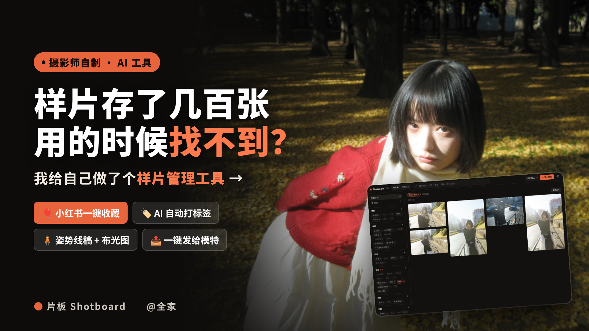
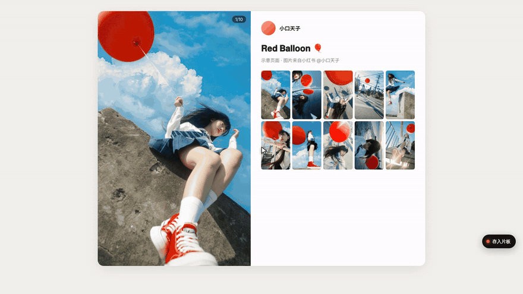
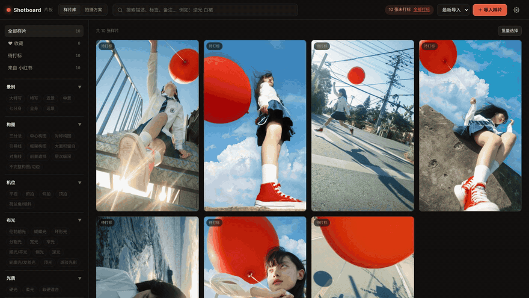
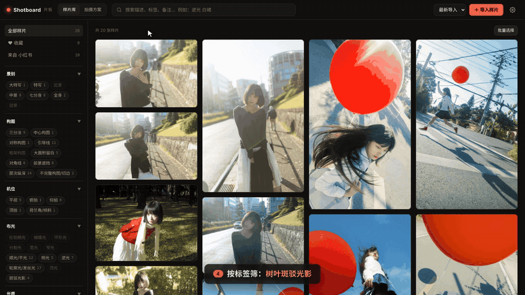
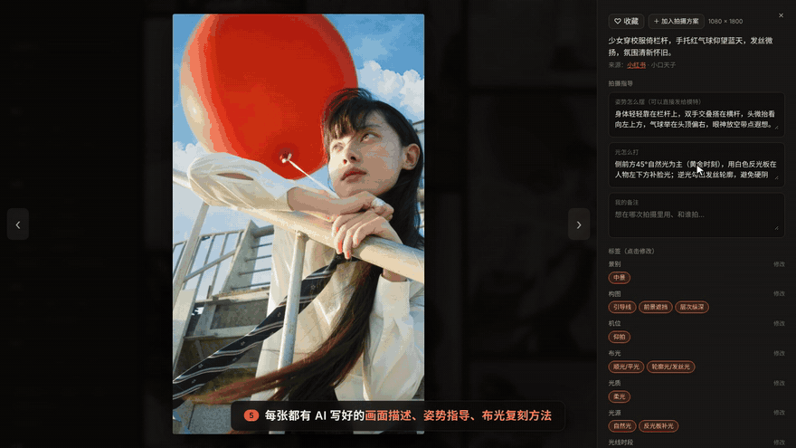
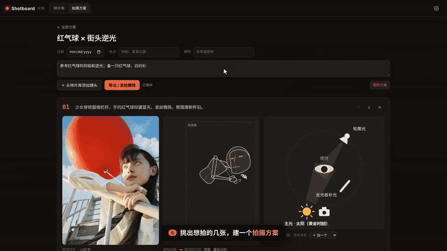

<h1 align="center">Shotboard 片板</h1>

  <b>A reference library for portrait photographers · AI auto-tagging · shoot plans your model can actually follow</b> 
  English · <a href="README.md">中文</a>

  
  
  
  

You save a great portrait reference, and then you can never find it again. Shotboard keeps your references in a local library that is **organized the way photographers think**:

- **One-click save from Xiaohongshu (RED) and Pinterest.** A browser extension saves every image in a post, together with the author and a link back to the original.
- **AI tagging across 13 dimensions.** Shot size, composition, camera angle, lighting pattern, light quality, light source, time of day, scene, outfit, color, mood, pose and number of people.
- **Combined filters.** For example "backlight + three-quarter shot" or "dappled light through leaves". You can also just search for "balloon".
- **Custom tags.** Group images your own way, such as "want to recreate" or "red accent".
- **Shoot plans.** Pick the shots you want to recreate. Shotboard draws a **mannequin pose sketch** and a **top-down lighting diagram** for each one, then exports everything as one long image you can send to your model.

All images and data stay on your own computer. You need your own Alibaba Cloud Qwen (DashScope) API key. You pay per image, it is cheap, and new accounts usually get free credits.

> The UI is currently in Chinese. English UI is on the roadmap. Contributions are welcome.

## Demo

**1. Save a whole Xiaohongshu post in one click**

**2. AI tagging.** Images you save and images you drag in are both tagged automatically.

**3. Combined filters and search**

**4. Custom tags**

**5. Shoot plans.** Mannequin pose sketches and a draggable lighting diagram, exported as one long image for your model.

> Photos in the demo: the red-balloon set is by @小口天子 on Xiaohongshu; the other set was shot by the author (全家). All rights belong to the photographers. Please do not reuse them.

---

## Getting started

### 1. Get a Qwen API key

1. Sign in to [Alibaba Cloud Model Studio](https://bailian.console.aliyun.com/). International accounts use the international Model Studio console.
2. Enable the model service. New accounts usually get free credits.
3. Create an **API Key**. It starts with `sk-`.
4. If your account is on the international site, set the region to "国际（新加坡）" (International, Singapore) in Shotboard's settings.

### 2. Download

Click **Code → Download ZIP** at the top of this page and unzip it, or run `git clone`.

Shotboard needs macOS and Python 3.9 or newer. If Python is missing, macOS will offer to install the Command Line Developer Tools the first time you run Shotboard. Click Install.

### 3. Install as a Mac app (recommended)

1. **Right-click** `安装到应用程序.command` ("Install to Applications"), choose Open, then click Open again in the dialog. The first run needs a right-click because macOS blocks downloaded scripts.
2. Wait for the installer to finish. The first install takes about 1–2 minutes.
3. Shotboard opens in its own window. Paste your API key in Settings, click Test, then Save.

Once installed:

- Launch Shotboard from Launchpad, the Applications folder or Spotlight. You don't need a terminal.
- Shotboard keeps running in the background and starts at login. The extension can save images and tagging continues after you close the window.
- To update, download the new version and run the installer again. Your library and settings are kept.
- To uninstall, run `卸载.command`. It asks whether to keep your library.

Not ready to install? Double-click `start.command` to run Shotboard from a terminal window instead.

### 4. Import references

Drag images or whole folders into the window, or click "＋ 导入样片" (Import). Shotboard accepts JPG, PNG, WebP and HEIC. Duplicates are skipped automatically.

## Browser extension

Works in Chrome, Edge, Arc and other Chromium browsers.

1. Open `chrome://extensions` and turn on **Developer mode**.
2. Click **Load unpacked** and choose the `extension` folder:
   - If you installed the Mac app, use `~/Library/Application Support/Shotboard/extension`. The installer copies this path to your clipboard.
   - If you run Shotboard with `start.command`, use the `extension` folder inside the project.
3. On a Xiaohongshu post or a Pinterest pin, click **存入片板** (Save to Shotboard) in the bottom-right corner. On any other site, right-click an image and choose "存到 Shotboard 片板".

The extension only reads the page you are looking at, and only when you click save, just like "Save image as". It does not crawl, page through results or touch your account. Use saved images as personal references only, and respect each platform's terms.

## Shoot plans

- Create a plan and add shots from your library.
- For each shot, Shotboard detects the body, hands and face **locally in your browser** using MediaPipe Holistic. It then draws an artist's-mannequin sketch with joints, fingers, spine, shoulder line and hip line. You can mirror the sketch so it's easier for the model to copy.
- Each shot also gets a top-down lighting diagram built from the lighting tags. You can drag lights and reflectors, and add or remove them.
- You also get a suggested focal length and time of day, plus pose and lighting notes you can edit.
- **Export** as a model version (poses and directions only) or a photographer version (with lighting). Save it as a long PNG for messaging apps, or print it to PDF.

## Customizing the taxonomy

All tag dimensions live in `app/taxonomy.json`. Edit the file and restart Shotboard. Tags the model invents that aren't in the taxonomy are discarded.

## Where your data lives

- Mac app: `~/Library/Application Support/Shotboard/data`
- `start.command`: `data/` inside the project folder

To back up, copy the whole `data` folder. It holds your images, thumbnails, the SQLite database and `config.json` (with your API key). `data/` is listed in `.gitignore`, so it never ends up in git.

## Tech

- Backend: Python, FastAPI and SQLite (`app/main.py`)
- Tagging: Qwen-VL through DashScope's OpenAI-compatible API (`app/tagger.py`)
- Frontend: vanilla HTML, CSS and JS with no build step (`app/static/`)
- Pose detection: [MediaPipe Holistic](https://github.com/google-ai-edge/mediapipe) (Apache-2.0), running in the browser
- Export: [html-to-image](https://github.com/bubkoo/html-to-image) (MIT)
- Extension: Chrome Manifest V3 (`extension/`)
- Mock mode for development: `SHOTBOARD_MOCK=1 python -m uvicorn app.main:app --port 8765` makes no API calls and assigns random tags

## Roadmap

- [x] Import, AI tagging, multi-dimension filters, search
- [x] Browser extension for Xiaohongshu, Pinterest and right-click saving on any site
- [x] Shoot plans with pose sketches, lighting diagrams and export
- [x] Mac app with background service
- [ ] Signed and notarized `.dmg` that needs no Python install
- [ ] English UI
- [ ] Find similar images with a local CLIP model

## License

[MIT](LICENSE) © 2026 全家. Third-party components in `app/static/vendor/` keep their own licenses. The demo images and GIFs in `docs/` are **not** covered by the MIT license.
