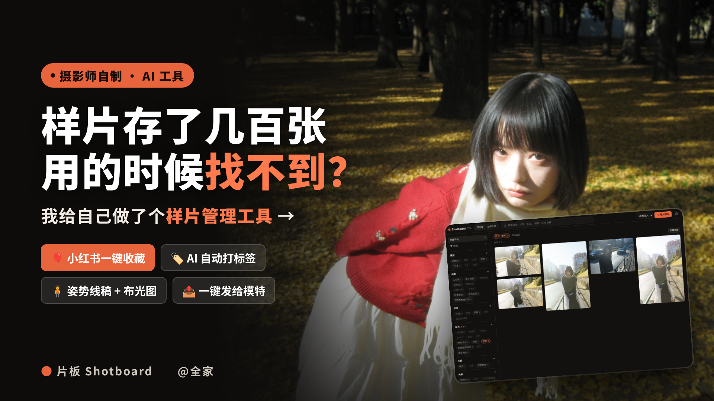
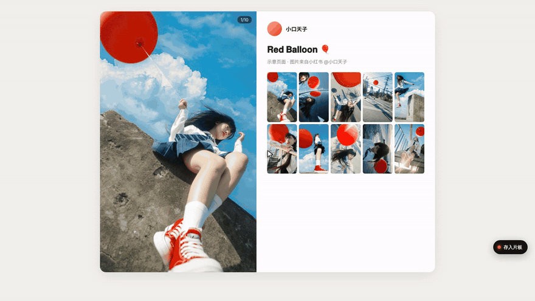
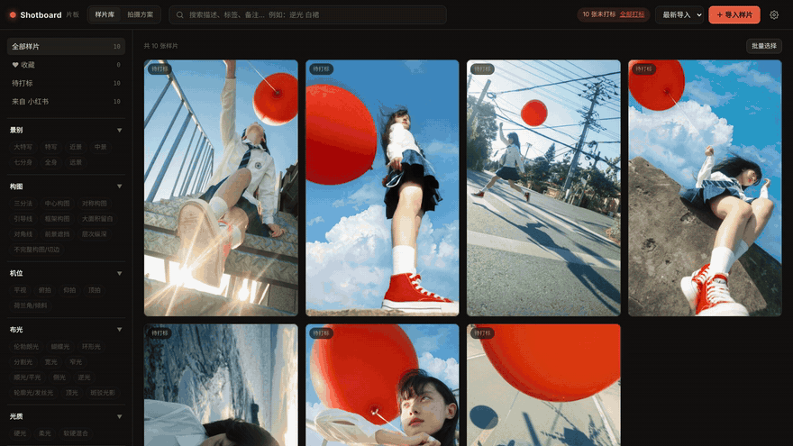
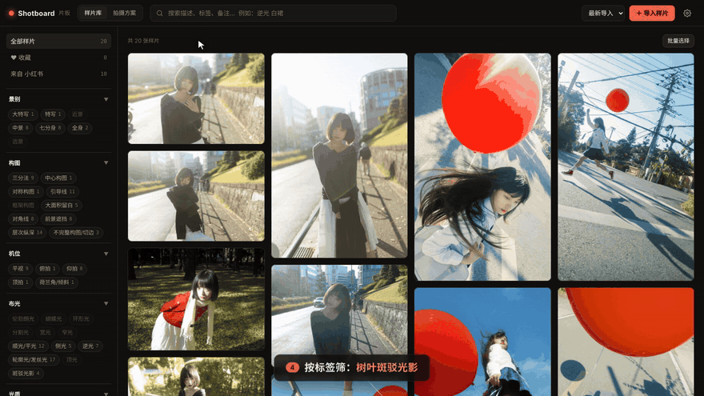
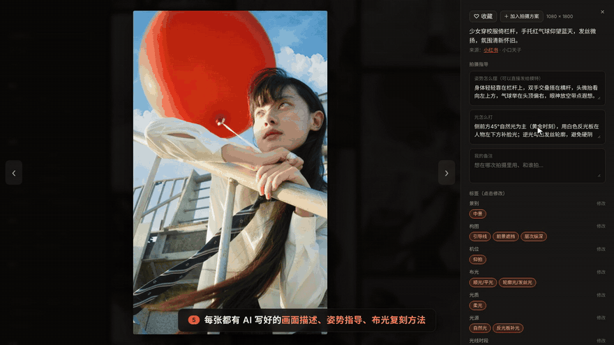
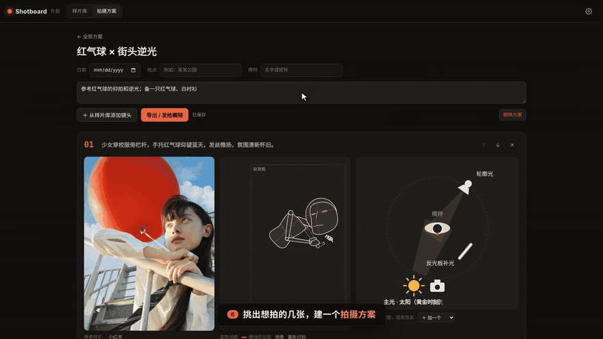

<p align="center"></p>

<h1 align="center">Shotboard 片板</h1>

<p align="center">
  <b>人像摄影样片库 · AI 自动打标签 · 一键生成给模特的拍摄方案</b><br>
  <a href="README.en.md">English</a> · 中文
</p>

<p align="center">
  
  
  
  
</p>

刷到好看的人像样片，存下来就再也找不到了？片板帮你把样片收进一个**按摄影维度整理好**的本地图库：

- **小红书一键收藏**：浏览器插件，整篇笔记的图连同作者、原帖链接一起存
- **AI 自动打标签**：景别、构图、机位、布光、光质、光源、时段、场景、服装、色调、情绪、姿态、人数，**13 个维度**
- **组合筛选**：比如「逆光 + 七分身」「树叶斑驳光影」，或者直接搜「气球」
- **自定义标签**：按自己的方式归类，比如「想复刻」「红色点缀」
- **拍摄方案**：挑几张想复刻的样片，自动生成**人偶姿势线稿**和**俯视布光图**，一键导出长图发给模特

所有图片和数据都只保存在你自己的电脑上。需要自备通义千问 API Key（按张计费，很便宜，新用户有免费额度）。

## 演示

**1. 小红书一键收藏**：整篇笔记的图一次存进来



**2. AI 自动打标签**：存进来的、自己拖进来的，都会自动打好 13 个维度的标签



**3. 组合筛选和搜索**



**4. 自定义标签**



**5. 拍摄方案**：人偶姿势线稿 + 可拖动的布光图，导出长图发给模特



> 演示中的样片：红气球一组为小红书 @小口天子 的作品；另一组为本人拍摄（全家）。版权归原作者所有，请勿转载。

---

## 第一次使用

### 1. 准备通义千问 API Key

1. 打开 [阿里云百炼控制台](https://bailian.console.aliyun.com/)，用阿里云账号登录（没有就注册一个，需要实名认证）
2. 开通「模型服务」，新用户一般有免费额度
3. 左侧找到 **API Key** → 创建一个，复制下来（以 `sk-` 开头）

> 用的是 Alibaba Cloud 国际站账号的话，去国际站的 Model Studio 创建 Key，并在设置里把「账号所在地区」选成「国际（新加坡）」。

### 2. 下载

点本页右上角绿色的 **Code → Download ZIP**，下载后双击解压。会用 git 的话也可以 `git clone`。

需要 macOS 和 Python 3.9 以上（第一次运行时如果没有，macOS 会提示安装「命令行开发者工具」，点安装即可）。

### 3. 安装成 Mac 应用（推荐）

1. **右键** `安装到应用程序.command` → 打开 → 在弹窗里再点一次「打开」
   （第一次需要右键打开，因为 macOS 会拦截下载来的脚本）
2. 等它跑完（第一次大约 1–2 分钟）。如果 macOS 提示安装「命令行开发者工具」，点安装，装完再运行一次
3. 完成后会自动打开 Shotboard 窗口；在设置里粘贴 API Key →「测试连接」→ 保存

之后：

- 从 **启动台 / 应用程序 / Spotlight** 打开 Shotboard，会打开一个独立窗口，不需要终端
- Shotboard 在后台常驻、开机自动运行：**关掉窗口后浏览器插件照样能存图，打标也会继续**
- macOS 可能会提示「已添加后台项目」，这是正常的。如果在「系统设置 → 通用 → 登录项」里把它关了，打开 Shotboard 时会临时启动，只是开机不会自动运行
- **更新新版本**：解压新版本，再运行一次 `安装到应用程序.command`，样片和设置都会保留
- **卸载**：运行 `卸载.command`，会问你要不要保留样片库

> 不想安装的话，也可以像以前一样双击 `start.command` 临时运行（要一直开着终端窗口）。

### 4. 导入样片

- 直接把图片或**整个文件夹**拖进浏览器窗口
- 或者点右上角「＋ 导入样片」
- 支持 JPG / PNG / WebP / HEIC，同一张图不会重复导入

导入后会在后台自动打标签，卡片左上角会显示「打标中」，完成后标签自动出现在左侧。

---

## 浏览器插件：小红书 / Pinterest 一键收藏

刷小红书时看到好的样片，点一下就能把整篇笔记的图存进片板，标题、作者和原帖链接也一起记下来。

### 安装（只需一次）

适用于 Chrome、Edge、Arc 等 Chromium 内核浏览器（Safari 不支持）。

1. 浏览器地址栏打开 `chrome://extensions`（Edge 是 `edge://extensions`）
2. 打开右上角的 **开发者模式**
3. 点 **加载已解压的扩展程序**，选择插件文件夹：
   - 装成了 Mac 应用：选 `~/Library/Application Support/Shotboard/extension`（安装脚本最后会把这个路径复制到剪贴板，在选择窗口里按 ⌘⇧G，⌘V 粘贴，回车）
   - 用 start.command 运行：选 `shotboard` 文件夹里的 `extension`
4. 点浏览器右上角的拼图图标，把「Shotboard 片板」固定到工具栏

> 以后更新插件：装成 Mac 应用的话，运行新版本的安装脚本后，回到 `chrome://extensions` 点插件卡片上的刷新按钮，再刷新已经打开的小红书页面即可。

### 使用

- **小红书**：打开任意一篇图文笔记，右下角会出现「存入片板」按钮 → 勾选想要的图（默认全选）→ 保存
- **Pinterest**：打开一个 Pin 的详情页，同样点「存入片板」，会尽量保存原图
- **其他任何网站**：在图片上右键 →「存到 Shotboard 片板」，插件图标上出现 ✓ 就是存好了
- 点插件图标可以看片板是否在运行、库里有多少张

存进来的图会自动打标签，在片板左侧可以按「来自 小红书」筛选。同一张图重复保存不会存两份。

**前提：片板要在运行**（装成 Mac 应用的话会一直在后台运行；用 `start.command` 的话终端窗口要开着）。没运行时插件会提示你。

### 说明

插件只在你**主动点保存**时，读取你当前正在看的这一篇笔记，和你右键「图片另存为」本质一样，不会自动翻页、批量抓取，也不会碰你的小红书账号。图片只存在你自己电脑上，请仅作个人拍摄参考，不要二次发布别人的作品。

---

## 拍摄方案：把样片变成给模特的拍摄指南

### 建方案、加镜头

- 顶部切到 **「拍摄方案」** → 新建方案，填日期、地点、模特、整体说明（风格、服装道具清单等）
- 点 **「从样片库添加镜头」** → 自动跳到样片库并进入选择模式，点卡片选图，点「加入方案」
- 也可以在样片库点 **「批量选择」**，或者在大图页点 **「＋ 加入拍摄方案」**

### 每个镜头会自动生成

- **姿势线稿**：在你电脑上本地识别样片里人物的身体、双手和脸，画成美术人偶的样子：肌肉粗细的四肢、关节球、胸廓和骨盆、手指、脚，以及脸部朝向的结构线。橙色虚线是脊柱中线、肩线和胯线，用来看身体的扭转和重心；浅橙色是模特的**左侧**，方便说「抬左手」；被遮挡、看不清的部位画成虚线。虚线框是原图的取景框。点「镜像」可以左右翻转，模特照着做更直观
- **布光图（俯视）**：根据布光标签自动摆好主光、反光板、轮廓光等的位置。可以**拖动**调整，「＋ 加一个」添加灯或反光板，选中后可以改名、删除；「恢复自动」回到自动生成的样子
- **建议**：景别对应的焦段、拍摄时间（比如黄金时刻对应日落前 1 小时）、场景、服装、情绪
- **姿势指导 / 布光说明 / 备注**：默认用样片的拍摄指导，可以针对这次拍摄改写，不影响样片库里的原文

镜头可以用 ↑ ↓ 调整顺序，按拍摄顺序排好。

### 导出

点 **「导出 / 发给模特」**：

- **模特版**：姿势线稿 + 姿势指导 + 场景、服装、情绪，没有技术细节
- **摄影师版**：再加上布光图、焦段、布光说明，给自己或助理
- 可选是否附上参考样片原图（私下发给模特没问题，不要公开发布别人的作品）
- **导出长图**：下载一张 PNG，直接发微信；**打印 / 存为 PDF**：在打印窗口里选「存储为 PDF」

> 第一次打开方案时，姿势识别模型需要加载几秒钟。识别结果会保存下来，之后不用再等。没有人物或者人物太小的图会显示「没识别到人物」。

---

## 日常使用

| 想做什么 | 怎么做 |
|---|---|
| 按维度筛选 | 点左侧标签。同一维度内多选是「或」，不同维度之间是「且」。比如选 *逆光 + 窗光* 和 *近景*，就是「逆光或窗光」的「近景」 |
| 搜索 | 顶部搜索框，会搜描述、标签、拍摄指导和你的备注，按 `/` 快速聚焦 |
| 看大图 / 改标签 | 点卡片。右侧标签点一下就切换，自动保存。`←` `→` 切换上下张，`Esc` 关闭 |
| 加自己的标签 | 大图页最下面「自定义标签」，比如「下次海边拍」「XX 模特」 |
| 记录出处 | 大图页「添加来源链接」，以后能找回原帖和作者 |
| 收藏 | 卡片右上角 ♡ |
| AI 标得不对 | 手动改，或点「重新打标」 |

---

## 费用参考

每张图调用一次视觉模型。`qwen3-vl-plus` 判断更准，`qwen3-vl-flash` 更便宜更快，可在设置里切换。具体价格以阿里云百炼官网为准，新用户通常有免费额度，几百张样片一般够试用。

---

## 修改分类体系

分类都在 `app/taxonomy.json` 里，用文本编辑器打开就能改：

```json
{
  "key": "scene",
  "label": "场景",
  "multi": true,
  "hint": "拍摄地点",
  "options": ["影棚纯色背景", "室内居家", "咖啡馆/餐厅", "…在这里加新的…"]
}
```

改完重启片板（装成 Mac 应用的话，重新运行一次安装脚本；用 `start.command` 的话关掉终端窗口再双击）。新加的标签只对之后打标的图生效，旧图可以在「重新打标」。

---

## 数据在哪里

装成 Mac 应用后，所有数据在 `~/Library/Application Support/Shotboard/data`（在访达里按 ⌘⇧G 粘贴这个路径就能打开），运行日志在 `~/Library/Logs/Shotboard/`。用 start.command 运行时，数据在 `shotboard/data`。

- `data/images/` 原图
- `data/thumbs/` 缩略图
- `data/library.db` 标签、备注等所有信息
- `data/config.json` 你的设置（含 API Key）

**备份时复制整个 `data` 文件夹即可。** 上传到 GitHub 时 `data` 文件夹会被自动忽略，不会泄露你的样片和 Key。

---

## 路线图

- [x] v0.1 导入、AI 自动打标、多维度筛选、搜索、拍摄指导
- [x] v0.2 浏览器插件：小红书 / Pinterest 一键收藏，任意网站右键收藏
- [x] v0.3 拍摄方案：挑选样片 → 自动生成姿势线稿 + 布光示意图 → 导出长图发给模特
- [x] v0.4 安装成 Mac 应用：独立窗口、后台常驻、开机自动运行
- [ ] 签名公证的 `.dmg` 安装包，不用装 Python
- [ ] Pinterest 画板同步（官方 API）
- [ ] 以图搜图、找相似构图（本地 CLIP 模型）

---

## 技术说明（给想参与开发的人）

- 后端：Python + FastAPI + SQLite，入口 `app/main.py`
- 打标：`app/tagger.py`，通过 DashScope 的 OpenAI 兼容接口调用 Qwen-VL，结果会按 `taxonomy.json` 校验，模型编造的标签会被丢弃
- 前端：原生 HTML / CSS / JS，无需构建，在 `app/static/`；拍摄方案在 `plans.js`，线稿和布光图在 `figures.js`
- 姿势识别：[MediaPipe Holistic](https://github.com/google-ai-edge/mediapipe)（Apache-2.0，身体 33 点 + 手 21 点 + 脸部网格）在浏览器里本地运行，模型文件在 `app/static/vendor/holistic/`
- 长图导出：[html-to-image](https://github.com/bubkoo/html-to-image)（MIT）
- 浏览器插件：Manifest V3，在 `extension/`。后台脚本下载图片后以 base64 发给 `POST /api/import-url`；小红书优先读取页面里的笔记数据，读不到时退回解析页面元素
- 测试模式：`SHOTBOARD_MOCK=1 python -m uvicorn app.main:app --port 8765`，不调用 API，随机打标

---

## 关于

由 **全家** 发起和维护。欢迎提 Issue 反馈问题和建议；想关注后续更新，可以在小红书 / 抖音关注「全家」。

## 许可证

[MIT](LICENSE) © 2026 全家

本项目包含的第三方组件：MediaPipe Holistic（Apache-2.0）、html-to-image（MIT），各自的许可证见 `app/static/vendor/`。`docs/` 里的演示图片和动图**不在** MIT 许可范围内，版权归原摄影师所有。

**使用须知**：浏览器插件只在你主动点击时保存当前页面的图片，仅供个人拍摄参考。请尊重原作者的版权，不要二次发布别人的作品，并遵守各平台的用户协议。
